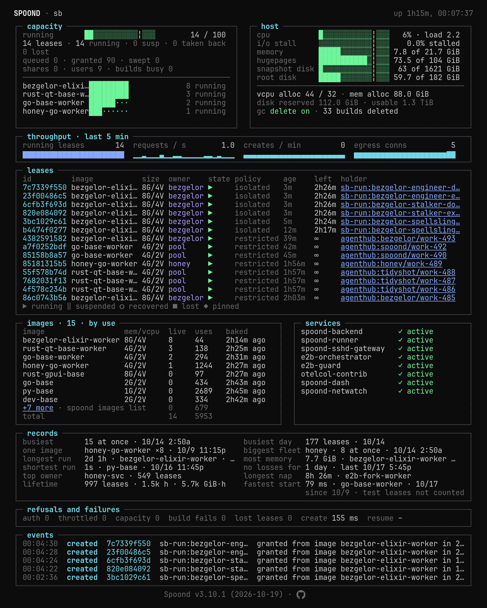

# spoond

Fast, isolated, ephemeral compute for people and agents: a lease API in
front of **Firecracker microVMs run by E2B's orchestrator**. Consumers
request a sandbox, run work in it, and release it. Every sandbox starts
as a memory-snapshot restore, so starts are warm, and fork, pause/resume
and checkpoint are native. On top: an SSH gateway, an HTTP proxy, an LLM
gateway, an MCP server for agents, a Forgejo Actions runner and a
read-only dashboard.



```
spoond (this repo, one Go binary)          e2b-orchestrator (our fork of
┌──────────────────────────────────┐       e2b-dev/runtime, patch queue)
│ lease API            :8890       │ gRPC  ┌──────────────────────────────┐
│ HTTP proxy, LLM gateway :8891    │ ────▶ │ Firecracker microVM lifecycle│
│ SSH gateway + ctl    :2222       │ :5008 │ memory snapshots (UFFD), NBD │
│ dashboard (read-only) :8893      │       │ rootfs, netns per sandbox,   │
│ MCP server for agents            │ envd  │ egress firewall, templates   │
│ Forgejo Actions runner           │ ────▶ │ envd in every guest (:49983) │
│ SQLite state (leases, catalog)   │ :5007 └──────────────────────────────┘
└──────────────────────────────────┘
images/*.dockerfile → docker → local registry → E2B templates (spoond images)
```

spoond is a generic microVM utility: it takes no position on how agents
work, and its clients drive it through the lease API. Since 2.0 it runs
on E2B's orchestrator; forkd, the 1.x substrate, is gone. The design,
decisions and per-unit specs are in
[docs/plans/2026-09-30-e2b-substrate/](docs/plans/2026-09-30-e2b-substrate/00-README.md),
and every change is in [CHANGELOG.md](CHANGELOG.md).

## What it gives you

- **Lease API**: `POST /api/leases` (image, size, TTL, persistent,
  network policy, exposed ports, holder, secrets), then exec, stream
  (WebSocket PTY), keepalive, suspend/resume,
  restart (warm or cold), checkpoint, restore, fork, clone, tag, comment,
  delete. Auth via bearer
  tokens (`CONSUMER_TOKENS=token=owner,...`) or per-user identity tokens.
  Leases and the image catalog persist in SQLite, so a backend restart
  loses nothing. On every lease:
  - **Files**: `/api/leases/{id}/files/{path}` puts, gets, stats, makes
    and removes files in the guest, up to 256 MiB per file.
  - **Background jobs**: `POST /api/leases/{id}/exec` with
    `"background": true` starts a tracked job (202 + `job_id`);
    `GET …/jobs/{job}?wait=<s>` long-polls to its exit, and
    `…/jobs/{job}/output` follows stdout/stderr by byte range, while
    `job_started`/`job_exited`/`job_lost` ride the event stream.
  - **Crash test**: on a host with `CRASH_TEST=1`, `POST
    /api/leases/{id}/crash-test` sends the caller's own lease through
    crash recovery (back from its last checkpoint with a new generation,
    or lost without one), so a client can test how it survives a crash.
  - **Guest port dial**: `GET /api/leases/{id}/ports/{port}/dial` opens
    raw TCP to any port in the guest over a WebSocket (a database's own
    protocol, a debugger, a REPL), under every network policy.
  - **Secrets as files**: a `secrets` object on create or exec becomes
    0600 files under `/run/secrets` on a guest tmpfs, never environment
    variables, argv, the store or logs.
  - **Event stream**: `GET /api/leases/events` (or one lease's
    `/events`) streams lifecycle events over SSE, with resumable
    positions.
  - **Generations**: a `generation` counter, also in
    `/run/spoond/generation` in the guest, bumped when the guest's memory
    did not continue (crash recovery, a cold or non-persistent restart, a
    restore), so a client can tell its processes were restored.
  - **Checkpoints on request**: no periodic checkpoints unless the lease
    asks (`checkpoint_interval`); `POST /checkpoint` any time, with
    `keep: true` to pin it (at most `MAX_KEPT_PER_LEASE`, default 4,
    within the owner's fair disk slice), and `POST /restore` puts the lease
    back to a kept checkpoint in place. `restart?mode=cold` gives the lease a fresh
    guest from its image, keeping its id.
  - **Named snapshots**: `POST /api/leases/{id}/snapshots` saves a live
    lease as a named, versioned checkpoint that outlives it (`name` or
    `name@v`); a later lease starts from it with `"snapshot":
    "spoond/warm@3"` (the version's memory, a new lease id and generation
    `1`). Saves are idempotent by an `idempotency_key`, the `/run/secrets`
    files are scrubbed before the checkpoint, and a name keeps its last
    `SNAPSHOT_KEEP_VERSIONS` versions. `GET`/`DELETE
    /api/named-snapshots/{name}[@v]` list, show and delete them. An
    owner may grant a name to another user
    (`/api/named-snapshot-grants`), who starts from it with
    `"snapshot_owner"`; only versions saved from a lease that never had
    a secret can be shared, and a lease started from a snapshot can
    restore back to it. On the
    source, spoond writes `/run/spoond/last-save`; on a lease started
    from a snapshot it writes `/run/spoond/lease-id`,
    `/run/spoond/generation` and `/run/spoond/started-from`, so a
    restored process can tell which side it is on — see
    [api.md](docs/api.md#identity-in-a-restored-guest).
  - **Holders and pins**: `holder` and `holder_url` are plain labels
    saying what holds a lease (a CI job, an orchestrator's run,
    someone's scratch work). A **pinned** lease (`pinned` on create, or
    `PUT/DELETE /api/leases/{id}/pin`) is never paused or deleted by
    spoond before its own expiry; take-back touches only unpinned
    leases, and every paused lease is released 30 days after its pause
    date by one clock. See
    [operations.md](docs/operations.md#pins-and-the-paused-release-clock).
- **Multi-user tenancy**: people and agents are first-class identities,
  with per-user SSH keys, per-user tokens, a per-user `max_ttl`, an
  equal fair share of memory and snapshot disk among active owners (no
  per-owner caps since 3.0), admin roles, lease sharing with expiry,
  per-user LLM gateway keys, and per-user proxy hostnames
  (`<label>.<user>.sandbox.example`). See
  [docs/security.md](docs/security.md) and the [Users & identity API
  section](docs/api.md#users--identity).
- **Fair shares**: every owner holding a running or paused lease gets
  an equal, floating 1/N slice of memory and snapshot disk (N counts
  active owners only — an identity that never took a lease does not
  split the box, and a lost lease never counts); an owner may borrow
  past it while the box has room. When a request does not fit, spoond
  takes room back from the biggest borrower (highest usage over
  slice): memory take-back
  pauses that owner's least recently used unpinned lease, and disk
  take-back releases their oldest unpinned paused lease. A shortage
  answers `503 capacity_wait` with `Retry-After`; a request take-back
  cannot serve (every candidate pinned, or the caller is itself the
  biggest borrower) answers `429 box_full`. `GET /api/usage` shows an
  owner's slice and ratio, lease and job counts, its creates waiting for
  room with their place in the queue, and its recent refusals and
  take-backs; `GET /api/usage/history` keeps 7 days of 15-minute
  samples. `GET /api/fair-shares` (admin) shows every owner's. A create may **wait** for room (`"wait": <seconds>`, up to
  `MAX_ADMIT_WAIT_SECS`), served lowest ratio first; a persistent lease
  may set `idle_suspend` to give its memory back when idle. See
  [upgrading-3.0.md](docs/upgrading-3.0.md).
- **Per-lease sizes**: a create picks its VM's size by preset
  (`"size": "large"`, listed by `GET /api/sizes`) or by `vcpu` and
  `memory_mb`; the image gives the default and a minimum. Sizes with a
  warm build (the image default and the presets an image lists in
  `warm_sizes`) start in milliseconds from a memory snapshot; any other
  size boots in about a second (`"start": "cold"`). Memory is the lease's
  charge for fair shares; vCPU is never charged. A lease keeps its size
  through pause, resume, clone, fork, restore and recovery, and a chosen
  size survives restarts too.
- **Resume on use**: a suspended lease, whatever suspended it
  (`idle_suspend`, take-back or its owner), resumes
  on its holder's next work call: exec, exec stream, files, guest dial,
  the proxy, jobs, the LLM gateway, a network change or a prompt. A
  resume that finds no room answers `503` `capacity_wait` with
  `Retry-After` and the lease stays suspended; no failed resume marks a
  lease lost. Automatic suspends name their reason on the lease and its
  `suspended` event.
- **Images**: one Dockerfile per capability in `images/`, built into E2B
  templates by `spoond images build <name>` (or `--all`). Every guest
  resolves names through the LAN resolver only and carries a container
  marker, so container tools such as kaniko work inside sandboxes.
- **SSH gateway**: `ssh new@sandbox.example` auto-creates a persistent
  sandbox; `ssh <lease-id>@sandbox.example` re-attaches; friendly names
  after `tag`. Sessions land in a tmux session.
- **Control plane over SSH**: `ssh ctl@sandbox.example "ls"` (pretty
  table by default; `--json` for raw). Verbs: `new`, `create`, `ls`,
  `stat`, `rm`, `keepalive`, `suspend`, `resume`, `restart`, `cp`
  (clone), `snapshot save|ls|show|rm`, `tag`, `comment`, `exec`,
  `share`, `ssh-key` (admin), `whoami`, `shelly`, `prompt`.
- **HTTP proxy**: `<lease-id>.sandbox.example` and `<id>-<port>`
  public URLs for sandbox web servers (Caddy fronts TLS).
- **LLM gateway**: per-lease OpenAI-compatible endpoint
  (`/llm/<lease-id>/openai/chat/completions`); upstream keys stay on
  the host, never inside sandboxes.
- **Agent access**: `spoond mcp`, an MCP stdio server with
  shell/read_file/write_file/edit_file/list_files/status tools, so any
  MCP-capable agent can work inside a lease.
- **Per-sandbox network policy**: `none` | `lan` | `internet` |
  `restricted` (with an egress allowlist), enforced by the orchestrator's
  egress firewall. `internet` and `lan` guests may call the lease API
  (CI jobs lease databases from inside their sandbox); `restricted` and
  `none` may not. Known limit: a domain in a `restricted` allowlist
  currently breaks HTTPS to allow-listed LAN IPs, so list IPs only.
- **Forgejo Actions runner**: `spoond runner` leases sandboxes as CI
  workers. On a full node a job waits for admission and retries instead
  of failing, and a job's `timeout-minutes` is enforced as in GitHub
  Actions (execution from sandbox creation), capped by
  `RUNNER_JOB_TIMEOUT` (default 6h, the whole job).
- **Dashboard**: `spoond dash` and `spoond top`, below.
- **Observability**: `/metrics` (Prometheus) covers the backend, the
  orchestrator (via an OpenTelemetry collector) and leases per state and
  per image. It needs an admin token or the scrape-only `METRICS_TOKEN`.
  Every lease create, release, loss and suspend also writes one line to
  the backend's journal (the lease journal), so `journalctl` alone can
  say what happened to a lease and why.
  `GET /readyz` answers uptime monitors such as Gatus (orchestrator,
  database, disk and hugepage checks; an example config is in
  [docs/operations.md](docs/operations.md#uptime-monitoring-gatus)).
- **Notifications**: with `NOTIFY_WEBHOOKS` set, the backend pushes what
  needs a person (a lost lease, a box_full refusal, a paused lease
  nearing its release, a pinned-idle notice, a unit down,
  disk or hugepages past their levels, a failed GC, a stale backup) to ntfy, Slack/Discord or any JSON
  receiver, with hourly dedupe, resolved messages, retries and a rate
  limit. `spoond notify test` checks the setup; see
  [docs/operations.md](docs/operations.md#notifications-to-webhooks).

## Dashboard

`spoond dash` is a read-only, live view of one spoond host in the
browser; `spoond top` draws the same view in a terminal. It shows
capacity and host health (CPU, memory, hugepages, disks), throughput,
the live leases, the image catalog, the systemd units, all-time records
from the lease history, refusals and failures, and the newest lease
events. A notifications panel appears above the rest only when the host
needs a person, such as a unit that is down or a snapshot disk past its
danger level. The view refreshes every 2 seconds. Problems with a single
lease are not shown there: spoond tells the lease's owner through the
lease event stream and the API.

On a host it runs as the `spoond-dash` unit on **:8893** (HTTPS, with
basic auth unless `DASH_AUTH=off`). Its data access is read-only:
`/metrics` through the scrape-only `METRICS_TOKEN` (which the lease API
refuses), the lease event stream through the events-only `EVENTS_TOKEN`,
the SQLite catalog opened read-only, user names from the identity store,
`/proc` and systemd.

Setting it up is manual today; generating the credentials as part of
installation is planned:

```bash
spoond dash hash 'the-password'   # bcrypt hash for DASH_PASSWORD_HASH
# /etc/spoond/backend.env: METRICS_TOKEN=<random>, then restart the backend
# /etc/spoond/dash.env:    DASH_USER, DASH_PASSWORD_HASH, METRICS_TOKEN,
#                          DASH_TLS_CERT, DASH_TLS_KEY; every setting is
#                          listed in cmd/spoond-dash/dash.go
```

## Install

spoond needs an x86-64 Linux host with KVM (bare metal, or a VM with
nested virtualisation), Debian 13, at least 16 GB of memory and a disk
or partition for the snapshot store. [docs/install.md](docs/install.md)
takes you through it in order: the host, the E2B orchestrator, spoond's
services, the image catalog and the first user. `spoond doctor` checks
the result.

## Docs

| Doc | Contents |
|---|---|
| [E2B substrate spec](docs/plans/2026-09-30-e2b-substrate/00-README.md) | the current platform: architecture, decisions, per-unit specs, ops appendices |
| [API reference](docs/api.md) | every endpoint: auth, request/response, errors; `GET /api/capabilities` self-describes the deployment |
| [Upgrading to 3.0](docs/upgrading-3.0.md) | what API clients change moving from 2.9 to 3.0 |
| [ctl reference](docs/ctl.md) | control-plane verbs, output contract, examples |
| [Usage guide](docs/usage.md) | SSH, exec, persistent/suspend, clones, proxy, LLM, agents, policies, multi-user |
| [Security](docs/security.md) | threat model, hardening notes, adversarial-review fixes |
| [Conformance suite](conformance/README.md) | the lease-API contract tests, run against production |
| [E2B upgrade runbook](docs/runbooks/e2b-upgrade.md) | moving the fork to a newer upstream |
| [Install](docs/install.md), [Setup](docs/setup.md) | bringing up an E2B host and spoond, first users and services |
| [Operations](docs/operations.md) | day-2: doctor, drain and reboots, the network watchdog, GC, backups, the dashboard |
| [Changelog](CHANGELOG.md) | what changed in each release |

## Status

**v3.10.0** (2026-10-17) is the current release. spoond 3.x shares a host
fairly: every active owner gets an equal, floating slice of memory and
snapshot disk, and when a request does not fit, spoond takes room back
from the biggest borrower. Since 3.9 it also pauses a lease on its own
before the host runs out of memory, and since 3.10 it resumes the
leases it paused once there is room again. Clients moving from 2.9 read
[docs/upgrading-3.0.md](docs/upgrading-3.0.md).

Every release and what changed in it is in [CHANGELOG.md](CHANGELOG.md)
and on the [releases page](https://github.com/jrimmer/spoond/releases).

## Build

One binary, all services; exclude any module with build tags:

```bash
go build -o spoond ./cmd/spoond                                   # all modules
go build -tags 'nobackend,nomcp,norunner' -o spoond ./cmd/spoond  # subset
```

Exclusion tags: `nobackend`, `nogateway`, `nomcp`, `norunner`,
`noctl`, `noimages`, `nocapabilities`, `nodoctor`, `nodrain`, `noinstall`, `nodash` (excludes `dash`
and `top` together), `nonotify`.

```bash
./spoond backend    # lease API, HTTP proxy, LLM gateway
./spoond gateway    # SSH gateway + ctl plane
./spoond mcp        # MCP endpoint
./spoond runner     # Forgejo Actions runner
./spoond ctl        # control-plane CLI
./spoond images     # build images into E2B templates; list the catalog
./spoond capabilities # what this spoond offers: images, sizes, policies, routes, surfaces
./spoond drain      # pause sandboxes before an orchestrator restart, resume after
./spoond install    # clean native install: check, host, runtime, spoond, images, doctor phases
./spoond doctor     # health checks (below)
./spoond dash       # read-only dashboard (browser)
./spoond top        # the dashboard grid in the terminal
./spoond notify test  # send a test message to every NOTIFY_WEBHOOKS receiver
```

`spoond doctor` checks the configuration, the orchestrator, the local
registry, the token seed, the SQLite database, the image catalog, the
pinned E2B artifacts (SHA-256, plus the Firecracker and kernel versions
builds still use), storage headroom, the backend, the SSH gateway port,
the LLM gateway, TLS, the drain unit, and the webhook receivers (their
reachability and any deliveries dropped in the last 24 h). It exits 1 if
any check fails.

## Configuration

spoond reads its settings from env files in `/etc/spoond`. The built-in
defaults are generic (`localhost`, `sandbox.example.com`), so a
deployment sets its own hosts and addresses. `spoond config show` lists
what a unit sets and anything that differs from the running backend;
`--all` lists every setting spoond knows. Any secret can come from a
file instead of a value (`<NAME>_FILE=/path`).

The settings you are most likely to change:

| Area | Settings (default) |
|---|---|
| Hosts and addresses | `SPOOND_GUEST_DNS_ADDR` (guest resolvers, comma-separated), `SPOOND_PROXY_HOST_SUFFIX`, `NODE_ID`, `HOST_GUEST_SERVICE_ADDR` (where guests reach host services), `HOST_API_PORT` (the lease API port `lan` and `internet` guests may reach) |
| Integrations | `METRICS_TOKEN`, `LLM_UPSTREAM_URL`, `NOTIFY_WEBHOOKS` |
| Memory | `MEMORY_OVERCOMMIT` (1.25 × the hugepage pool), `MEMORY_FLOOR_MIB` (2048) |
| Disk and state | `SPOOND_DB_PATH`, `DISK_RESERVE_PCT` (5, the share of snapshot disk kept free) |
| Lease sizes | `SIZE_PRESETS` (`small=1:2048,medium=2:4096,large=4:8192,xlarge=8:16384`), `MAX_LEASE_VCPU` (the host's cores), `MAX_LEASE_MEMORY_MB` (32768) |
| Waiting and idling | `MAX_ADMIT_WAIT_SECS`, `IDLE_SUSPEND_DEFAULT_SECS`, `SATURATION_IO_FULL_PCT` (20), `SATURATION_CPU_SOME_PCT` (75) |
| Paused leases | `PAUSED_RELEASE_DAYS` (30), `PINNED_IDLE_NOTICE_DAYS` (7) |
| Snapshots | `MAX_KEPT_PER_LEASE` (4), `MAX_NAMED_SNAPSHOTS`, `SNAPSHOT_KEEP_VERSIONS`, `SNAPSHOT_WRITE_CONCURRENCY` |
| Jobs and exec | `MAX_RUNNING_JOBS_PER_LEASE`, `JOB_RETENTION_SECS`, `JOB_MAX_RUNTIME`, `MAX_EXEC_BODY_BYTES` |
| CI runner | `RUNNER_ADMIT_WAIT_SECS`, `RUNNER_JOB_TIMEOUT` (6h) |
| Drain and recovery | `DRAIN_SNAPSHOT_CONCURRENCY`, `UNDRAIN_*`, `RECOVERY_RETRY_*`, `ROOTFS_PROBE_SECS`, `SWEEP_TIMEOUT`, `E2B_CREATE_TIMEOUT` and the other per-call E2B limits |
| Housekeeping and testing | `ORPHAN_REAP` (`dryrun`), `CRASH_TEST` |

More detail:

- A deployment's own hosts and addresses: [PRODUCTION-ENV-2.7.md](deploy/PRODUCTION-ENV-2.7.md).
- The E2B deployment's fixed addresses, ports and paths: [01-architecture.md](docs/plans/2026-09-30-e2b-substrate/01-architecture.md).
- Pins and the paused-release clock: [operations.md](docs/operations.md#pins-and-the-paused-release-clock).

## Tests

```bash
go test ./...            # unit tests (fast, no infra)
```

The conformance suite (`conformance/`, build tag `conformance`) is the
executable definition of the lease-API contract. It runs on the host
against a live spoond, as root; see [conformance/README.md](conformance/README.md).

## License

BSD-3-Clause from 2.4.0 (2.3.3 and earlier: Apache-2.0); see
[`LICENSE`](LICENSE) and [`NOTICE`](NOTICE), which lists the
third-party files that keep their own licenses.
Contributions welcome: see [`CONTRIBUTING.md`](CONTRIBUTING.md).
